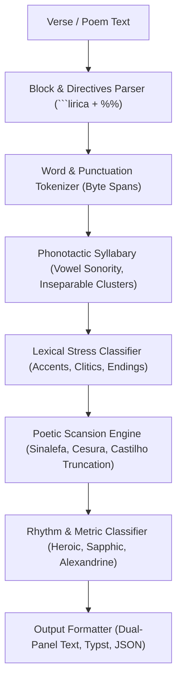

# Technical Specification: Deterministic Poetic Scansion and Rhythm Analysis Engine

- **Ticket:** #1
- **Branch:** `feat/1-poetic-scansion-engine`
- **Standard:** GOST DD-TDD v1.5.0
- **Status:** In Progress (Phase 3: Spec)

---

## 1. Overview & Scope

This specification defines the architecture, data structures, and algorithmic contracts for **`joaju-lirica`**, a high-performance, deterministic Rust engine for Portuguese poetic scansion, rhythm analysis, and metric classification.

The engine operates on UTF-8 text with zero external runtime dependencies (`std` only in the core library). It preserves exact byte ranges (`Range<usize>`) across all syllables to support real-time editor integrations (Ratatui TUI, egui, Dioxus, Neovim extmarks, Obsidian ghost text) without buffer reallocations.

---

## 2. Architecture & Pipeline



---

## 3. Core Data Structures

### 3.1 `SilabaPoetica`
```rust
use std::ops::Range;

#[derive(Debug, Clone, PartialEq, Eq)]
#[cfg_attr(feature = "serde", derive(serde::Serialize, serde::Deserialize))]
pub struct SilabaPoetica {
    /// Visual representation of the syllable (e.g. "que_ar" on elision).
    pub texto: String,
    /// Exact byte range `start..end` in the original line.
    pub span: Range<usize>,
    /// Whether this syllable carries metric stress (tonic).
    pub tonica: bool,
    /// 1-based metric position (Some(1..=N) up to the final tonic; None for post-tonic syllables).
    pub numero_metrico: Option<usize>,
    /// Indicates whether this syllable resulted from cross-word elision (sinalefa).
    pub fusao: bool,
}
```

### 3.2 `EscansaoVerso`
```rust
#[derive(Debug, Clone, PartialEq, Eq)]
#[cfg_attr(feature = "serde", derive(serde::Serialize, serde::Deserialize))]
pub struct EscansaoVerso {
    /// Ordered sequence of poetic syllables.
    pub silabas: Vec<SilabaPoetica>,
    /// Metric count according to the active rule (Castilho by default).
    pub total_metricas: usize,
    /// 1-based positions of tonic syllables (e.g., [2, 6, 10]).
    pub esquema_tonico: Vec<usize>,
    /// Metric classification if recognized (e.g. Heroic Decasyllable).
    pub classificacao: Option<String>,
}
```

### 3.3 `PoemaConfig` & Directives
```rust
#[derive(Debug, Clone, PartialEq, Eq)]
pub struct PoemaConfig {
    pub titulo: Option<String>,
    pub autor: Option<String>,
    pub metro_alvo: Option<String>,
    pub elidir_pontuacao: bool,      // default: false (punctuation creates cesura)
    pub dierese_crescente: bool,     // default: false (treat as diphthong unless accented)
    pub contagem_castilho: bool,     // default: true (stop counting at final tonic)
    pub analisar_rima: bool,         // default: true
    pub modo_saida: ModoSaida,       // Typst, Painel, Json, Texto
}
```

---

## 4. Algorithmic Modules

### 4.1 `phonotactics`
- Sonority scale: `a > e, o > i, u`.
- Inseparable onsets: `ch`, `lh`, `nh`, `qu`, `gu`, and `[bcdfgptv] + [lr]`.
- Unstressed hiatus rule: in word-final or medial `-ia`, `-ie`, `-io`, `-ua`, `-uo`, if there is no preceding graphic accent anywhere in the word, the vowels form a hiatus (*po-e-si-a*, *ru-a*, *di-a*, *fri-o*). If there is an antecedent accent (*his-tó-ria*, *gló-ria*), they form a rising diphthong unless `dierese_crescente` is enabled.
- Manual dieresis operator `/` inside words forces syllable break (e.g., `ru/a`, `sa/u-da-de`).

### 4.2 `tonic`
- Graphic accent precedence: acute (`á, é, í, ó, ú`), circumflex (`â, ê, ô`), and tilde (`ã, õ`).
- Clitics (unstressed monosyllables): `o, a, os, as, um, uns, de, do, da, dos, das, em, no, na, nos, nas, por, pelo, pela, pelos, pelas, com, sem, sob, para, pra, pro, me, te, se, lhe, lhes, nos, vos, que, e, mas, ou, como`.
- Unaccented polysyllables:
  - Words ending in `a(s)`, `e(s)`, `o(s)`, `em`, `ens` are paroxytone (penultimate syllable stressed).
  - Words ending in `r`, `l`, `z`, `x`, `i(s)`, `u(s)`, `im`, `ins`, `um`, `uns` are oxytone (last syllable stressed).

### 4.3 `scansion`
- Tokenizes words with leading and trailing punctuation spans.
- Punctuation cesura: commas, semicolons, dashes (`—`, `-`), colons, and question/exclamation marks block automatic sinalefa between words, unless overridden by the `_` operator or `elidir_pontuacao = true`.
- Sinalefa / Elision: adjacent vowel sounds between words are merged when the boundary conditions are satisfied. Stress clash (two consecutive stressed syllables) prevents automatic fusion.
- Castilho Rule: metric syllable count terminates on the verse's last tonic syllable. Subsequent syllables receive `numero_metrico: None`.

### 4.4 `classifier`
- 10 syllables:
  - Tonic at 6 and 10: *Decassílabo Heroico*
  - Tonic at 4, 8 and 10: *Decassílabo Sáfico*
  - Tonic at 3, 6 and 10: *Decassílabo Martelo*
- 7 syllables: *Redondilha Maior*
- 5 syllables: *Redondilha Menor*
- 12 syllables (tonic at 6 and 12): *Alexandrino Clássico*
- Other lengths: descriptive naming (*Hexassílabo*, *Octossílabo*, *Eneassílabo*, *Dodecassílabo*).

### 4.5 `block` & `render`
- Parses ````lirica blocks containing `%% key = value` headers followed by stanza lines.
- Renders:
  - Dual-panel human readable text (original line vs formatted scansion with stress tags and metric summary).
  - Typst output (`#figure(...)` or dedicated typographic styling).
  - JSON serialization for API and editor consumption.

---

## 5. Test Suite (TDD Acceptance Criteria)

1. **Camões Classic Heroic**: *"Amor é fogo que arde sem se ver"* -> 10 syllables, tonic at [2, 6, 10], classified as *Decassílabo Heroico*, `que_ar` merged.
2. **Punctuation Cesura**: *"Amor, ardente sem se ver"* -> `Amor,` does not elide with `ardente` due to comma.
3. **Manual Overrides**:
   - `ru/a` forces 2 syllables with split.
   - `amor_eterno` forces elision across boundary.
4. **Hiatus vs Diphthong**:
   - `poesia` -> `po-e-si-a` (4 syllables, tonic at `si`).
   - `história` -> `his-tó-ria` (3 syllables, tonic at `tó`).
5. **Byte Span Consistency**:
   - `s.texto` matches `&line[s.span]` (or composite slice for elisions) exactly across multibyte UTF-8 characters.
6. **Block & Directive Parser**:
   - `%% elidir_pontuacao = true` correctly merges across commas.
